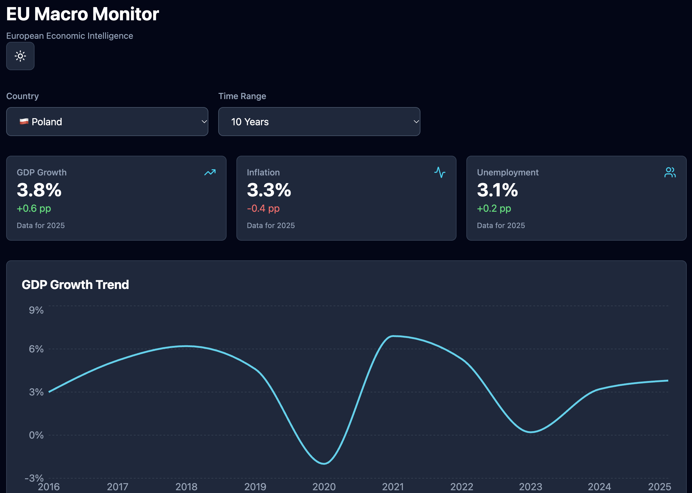

# EU Macro Monitor

**An interactive dashboard for exploring European macroeconomic indicators using real Eurostat data.**

EU Macro Monitor is a responsive web application built with React. It allows users to explore GDP growth, inflation, and unemployment across selected European countries, visualize historical trends, and compare economic performance over time.

The project demonstrates frontend development combined with economic data analysis and REST API integration.

## Dashboard Preview



**Live Demo:** https://eu-macro-monitor.vercel.app

## Features

- **Real economic data:** Integration with Eurostat REST APIs.
- **Country selection:** Switch between Poland, Germany, France, and the Netherlands.
- **Economic KPI cards:** Latest available GDP growth, inflation, and unemployment rates, including year-over-year changes.
- **Interactive visualization:** Historical GDP trends using Recharts, with tooltips and animated transitions.
- **Time-range filtering:** Display the last 3, 5, or 10 available annual observations.
- **Light and dark themes:** Manual theme switching.
- **Responsive design:** Layouts for desktop, tablet, and mobile.
- **Error handling:** Loading indicators, error messages, and missing-data states.
- **Request cancellation:** Prevent outdated API requests from overwriting newer results.

## Tech Stack

| Technology        | Purpose                            |
| ----------------- | ---------------------------------- |
| React             | UI components and state management |
| JavaScript        | Application logic                  |
| Vite              | Development and production builds  |
| Tailwind CSS      | Styling and responsive design      |
| Recharts          | Interactive data visualization     |
| Lucide React      | Icons                              |
| Eurostat REST API | Economic data                      |
| ESLint            | Code quality                       |

## Architecture

The application separates data retrieval, transformation, business logic, and presentation.

```text
Eurostat REST API
       |
       v
API Service
       |
       v
Data Transformation
       |
       v
Custom React Hook
       |
       v
Application State
       |
       +----> KPI Cards
       |
       +----> GDP Chart
```

**Key implementation details:**

- Reusable `useEurostatData` custom hook for asynchronous fetching, request cancellation, and error handling.
- Shared JSON-stat transformation function for extracting, validating, and sorting time-series observations.
- Reusable KPI calculation function for identifying the latest observation and calculating changes against the preceding calendar year.
- Presentational React components that receive data through props.

## Data Sources

Economic data is retrieved from [Eurostat](https://ec.europa.eu/eurostat).

| Indicator                | Dataset         |
| ------------------------ | --------------- |
| Real GDP growth          | `tec00115`      |
| Annual HICP inflation    | `prc_hicp_ainr` |
| Annual unemployment rate | `une_rt_a`      |

The dashboard uses annual observations. Year-over-year differences between rates are expressed in percentage points (pp).

Data availability and the latest reporting year may differ between indicators and countries.

## Getting Started

### Prerequisites

- Node.js
- npm

### Installation

Clone the repository:

```bash
git clone https://github.com/YOUR_USERNAME/eu-macro-monitor.git
cd eu-macro-monitor
```

Install dependencies:

```bash
npm install
```

Start the development server:

```bash
npm run dev
```

Open the local URL displayed in your terminal.

### Production Build

```bash
npm run lint
npm run build
npm run preview
```

## Future Improvements

- Additional economic indicators and visualizations
- Multi-country comparisons
- Automated tests for data transformations and KPI calculations
- Data export functionality

## Author

Developed as a portfolio project demonstrating React frontend engineering, economic data visualization, and data-driven application development.

## License

No license specified.
